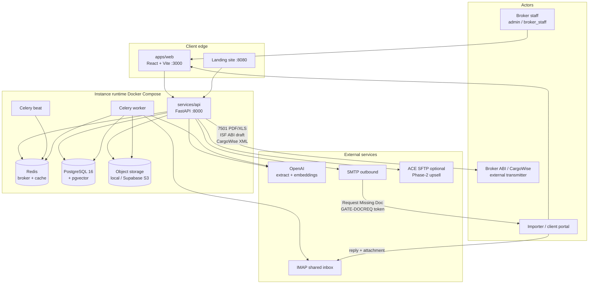
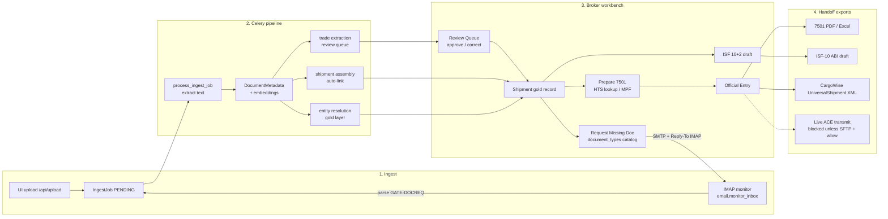
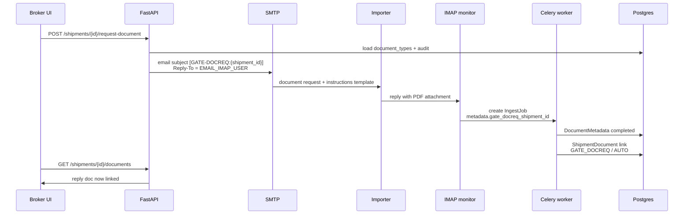

# GATE Architecture & Data Flow

Dedicated **single-tenant** customs-broker workbench: AI document intake, compliance triage, CBP 7501 / ISF / CargoWise entry prep.  
Live ACE/ISF SFTP is optional (Phase 2); default production mode is **export-only**.

Related: [PILOT_ONBOARDING.md](PILOT_ONBOARDING.md) · [PILOT_ACE.md](PILOT_ACE.md) · [PILOT_SMTP.md](PILOT_SMTP.md)

---

## 1. System architecture

### Runtime components

| Component | Role |
|-----------|------|
| `apps/web` | Broker UI: **Workbench** home (`/dashboard`), ingest, review, shipments, 7501 prep, settings; **System Health** under System (`/admin/dashboard`) |
| `services/api` | FastAPI routes, auth (scrypt portal sessions), exports |
| Celery worker | Ingest, extract, embed, assemble, email monitor |
| Celery beat | Schedules `email.monitor_inbox` and other periodic jobs |
| PostgreSQL + pgvector | Operational data + embeddings |
| Redis | Celery broker/result backend |
| Storage | Local volume or Supabase S3-compatible bucket |

---

## 2. End-to-end data flow

### Lakehouse layers (conceptual)

| Layer | Stores | Examples |
|-------|--------|----------|
| Bronze | Raw uploads / jobs | `ingest_jobs`, storage objects |
| Silver | Extracted / resolved entities | `document_metadata`, parties, extraction results |
| Gold | Broker work objects | `shipments`, `entries`, review queue, ISF |

---

## 3. Missing-document reply correlation

**Requirements for auto-link:** `EMAIL_IMAP_*` configured, importer replies (or forwards) so the monitored inbox receives the attachment **and** the subject still contains `[GATE-DOCREQ:{uuid}]`.

---

## 4. Key API / worker map

| Concern | Entry points |
|---------|----------------|
| Workbench home | `GET /api/workbench/summary` → `/dashboard` |
| Auth | `/api/portal/login` (scrypt), API keys with scopes |
| Upload | `/api/upload`, storage callbacks |
| Review | `/api/review/*` |
| Shipments | `/api/shipments/*`, `POST .../request-document` |
| Doc type catalog | `GET /api/reference-data/document-types` |
| Entries / 7501 | `/api/entries/*`, prep + PDF/Excel/CargoWise export |
| ISF | `/api/isf/*` (simulation gated in production) |
| Workers | `process_ingest_job`, `extract_trade_document`, `process_shipment_assembly`, `email.monitor_inbox` |

---

## 5. Production safety defaults (pilot)

| Setting | Pilot value | Effect |
|---------|-------------|--------|
| `ENVIRONMENT` | `production` | Enables production guards |
| `ACE_ALLOW_SIMULATION` | `false` | Blocks fake ACE/ISF “filed” states |
| `ACE_SFTP_ENABLED` | `false` | Export-only until live circuit |
| `AUDIT_LOG_RETENTION_DAYS` | `2555` | 19 CFR Part 163 (7 years) |
| `SEED_DEMO_USERS` | `false` | No demo logins on customer instance |
